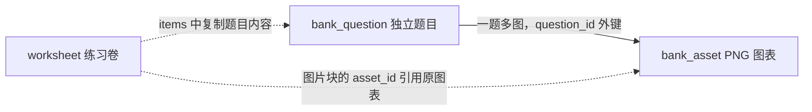

# 拾题数据库设计说明

当前应用使用一个 SQLite 数据库，将确认后的独立题目、局部图表和练习卷保存在本机。数据结构由三张业务表组成：`bank_question`、`bank_asset`、`worksheet`。题目内容采用有序 JSON 内容块，几何图采用 JSON 并渲染为 SVG，裁剪图表采用 PNG 二进制，练习卷保存组卷时的题目快照。

本文对应当前题库与组卷实现，不包含已移除的旧单题、整卷错题和 PostgreSQL 参考设计。示例均为虚构数据。

## 阅读导航

- [存储位置与初始化](#存储位置与初始化)
- [实体关系与设计取舍](#实体关系与设计取舍)
- [实际建表语句](#实际建表语句)
- [题目表](#题目表)
- [题目内容与内容块](#题目内容与内容块)
- [图表表](#图表表)
- [练习卷表](#练习卷表)
- [从识别到组卷的数据流](#从识别到组卷的数据流)
- [校验约束与事务](#校验约束与事务)
- [接口与存储的对应关系](#接口与存储的对应关系)
- [查询和检查示例](#查询和检查示例)
- [当前边界与扩展注意事项](#当前边界与扩展注意事项)

## 存储位置与初始化

默认路径是项目目录下的 `data/notebook.sqlite3`。这是包含表结构与实际数据的 SQLite 二进制文件，不是 SQL 文本。

数据目录按以下优先级确定：

1. `create_app(data_dir=...)` 传入的非空参数，主要用于测试。
2. 环境变量 `EXAM_DATA_DIR`。
3. 项目根目录下的 `data`。

例如，在项目目录启动一个独立数据目录：

```sh
EXAM_DATA_DIR=./local-data .venv/bin/python app.py
```

数据库会位于 `./local-data/notebook.sqlite3`。相对路径按启动程序的工作目录解析。

初始化调用关系：

```text
app.py / create_app()
  ├─ 确定数据目录并创建目录
  ├─ dbpath = data / "notebook.sqlite3"
  └─ make_bank(dbpath)
       ├─ sqlite3.connect(dbpath)
       ├─ PRAGMA foreign_keys=ON
       ├─ executescript(...) 创建三张表及一个业务索引
       └─ 注册题库和组卷接口
```

- [app.py](app.py) 负责应用启动及路径选择。
- [bank.py](bank.py) 的 `make_bank()` 是当前建表 SQL 的唯一代码来源；其中的 `connect()` 为各次连接启用外键检查。
- [image_utils.py](image_utils.py) 负责图像校验、方向纠正和元数据清理。
- [codex_ocr.py](codex_ocr.py) 负责结构化识别子进程，不直接访问业务数据库。

当前没有独立的 `.sql` 文件。下文 SQL 是代码的说明性副本，修改表结构时应修改 `bank.py` 并同步本文。

`CREATE TABLE IF NOT EXISTS` 允许重复启动，但不会修改已有表的结构，也不是数据库迁移系统。程序不迁移旧数据、不初始化旧表，也不主动删除已有数据库中的旧表或磁盘文件。

## 实体关系与设计取舍



实线是数据库外键关系；虚线是 JSON 中的逻辑关系，不受外键检查保护。

| 设计 | 原因 | 代价或边界 |
| --- | --- | --- |
| 一道主问题一条题目记录 | 题目可独立检索、选择和组卷 | 共用题干需要复制到依赖它的题目中 |
| 学科、题型、来源放普通列 | 便于分类、查询和建立索引 | 学科与题型还在 JSON 中重复保存 |
| 题面放 JSON | 支持不同数量、不同顺序的文字、公式、图片、选项和小问 | JSON 内部关系主要由应用校验 |
| 图表放 BLOB | 图片与题目能在同一事务中保存，备份不必另外收集图片文件 | 图片会增加数据库文件体积 |
| 练习卷保存题目快照 | 固定组卷时的文字内容、顺序和留白 | 重复存储题面，图片仍依赖原资产 |

当前没有试卷原图表、学生表、作答表、知识点字典表或题目版本表。

## 实际建表语句

以下定义与 `bank.py` 中的初始化语句一致：

```sql
CREATE TABLE IF NOT EXISTS bank_question (
    id INTEGER PRIMARY KEY AUTOINCREMENT,
    subject TEXT NOT NULL,
    kind TEXT NOT NULL,
    source TEXT NOT NULL,
    content TEXT NOT NULL,
    created_at TEXT DEFAULT CURRENT_TIMESTAMP
);

CREATE TABLE IF NOT EXISTS bank_asset (
    id TEXT PRIMARY KEY,
    question_id INTEGER NOT NULL REFERENCES bank_question(id),
    content BLOB NOT NULL
);

CREATE TABLE IF NOT EXISTS worksheet (
    id TEXT PRIMARY KEY,
    title TEXT NOT NULL,
    items TEXT NOT NULL,
    created_at TEXT DEFAULT CURRENT_TIMESTAMP
);

CREATE INDEX IF NOT EXISTS bank_classification
ON bank_question(subject, kind);
```

术语说明：`PRIMARY KEY` 是记录的唯一标识；`REFERENCES` 是外键；`NOT NULL` 禁止数据库空值；`DEFAULT` 在插入时省略字段的情况下提供默认值；索引用于帮助查询，不是额外业务字段。

这些表不是 SQLite `STRICT` 表，普通类型声明不等于全面的类型校验。题型枚举、JSON 格式、字符串长度等由应用层验证。

## 题目表

`bank_question` 的一条记录表示一道可独立使用的题目。

| 字段 | 数据库定义 | 含义 | 示例 |
| --- | --- | --- | --- |
| `id` | `INTEGER PRIMARY KEY AUTOINCREMENT` | 数据库生成的题库 ID | `42` |
| `subject` | `TEXT NOT NULL` | 学科 | `数学` |
| `kind` | `TEXT NOT NULL` | 题型 | `解答题` |
| `source` | `TEXT NOT NULL` | 人工填写的来源说明，不是来源表外键 | `七年级期中卷` |
| `content` | `TEXT NOT NULL` | 序列化后的题目 JSON 对象 | 见下一节 |
| `created_at` | `TEXT DEFAULT CURRENT_TIMESTAMP` | 入库时间 | `2026-11-22 02:30:00` |

`CURRENT_TIMESTAMP` 在 SQLite 中默认产生 UTC 时间文本。上例对应北京时间 2026 年 11 月 22 日 10:30。当前时间列没有显式 `NOT NULL`，只是应用插入时省略它以使用默认值。

应用通过 `json.dumps(..., ensure_ascii=False)` 保存 JSON，读取时使用 `json.loads()`。中文无需转为 Unicode 转义序列。

### 三种题号

| 名称 | 是否数据库独立列 | 用途 |
| --- | --- | --- |
| `id` | 是 | 题库记录身份，例如 `42` |
| `number` | 否 | 接口根据 ID 生成展示编号，例如 `Q000042` |
| `source_number` | 否，在 `content` 内 | 原卷题号，例如 `12` |

`number` 的生成方式是 `f"Q{id:06d}"`，至少六位数字，超过六位不会截断。编号不保证连续，不应通过编号推算题目总数。

练习卷中的第 1、2、3 题则由 `items` 的数组顺序生成，不改变题库 ID 或原卷题号。

### 分类索引

`bank_classification` 索引覆盖 `(subject, kind)`，可用于按学科或学科加题型过滤。当前题库列表接口仍执行全量查询 `ORDER BY id DESC`，筛选由浏览器完成，因此它尚未使用分类 SQL 查询。仅按题型查询也不应假设能像按索引前导列查询一样高效。

## 题目内容与内容块

### 题目 JSON 字段

| 字段 | JSON 类型 | 含义 | 示例 |
| --- | --- | --- | --- |
| `source_number` | 字符串 | 原试卷题号 | `"12"` |
| `subject` | 字符串 | 学科 | `"数学"` |
| `kind` | 字符串 | 题型 | `"解答题"` |
| `tags` | 字符串数组 | 知识点标签，无独立字典表 | `["三角形内角和"]` |
| `blocks` | 对象数组 | 按显示顺序排列的题面 | 文字、公式、图片混排 |
| `choices` | 字符串数组 | 选择题选项 | `["A. 60°", "B. 70°"]` |
| `parts` | 字符串数组 | 同一主问题的小问 | `["求角C的大小。"]` |
| `warnings` | 字符串数组 | 模糊、缺失或不确定的识别提示 | `["角度标注模糊，请核对"]` |

题型只接受 `选择题`、`填空题`、`计算题`、`解答题`、`其他`。字符串数组没有唯一性约束，例如 `tags` 不会自动去重。

`subject` 和 `kind` 同时存在于普通列及 JSON 中。保存时两份数据来自同一个校验结果，但数据库不强制它们相等。列表返回时这两个字段取自 JSON；以后实现编辑功能时必须同步维护。

`source` 则只存普通列。接口通过 `public()` 将 JSON 展开，再补上 `id`、`number`、`source`、`created_at`。

### 内容块字段

| 字段 | 使用阶段 | 含义 |
| --- | --- | --- |
| `type` | 全部阶段 | `text`、`latex`、`image`、`geometry` 四选一；geometry 的完整结构见下节 |
| `text` | 全部阶段 | 普通文字、LaTeX 源码，或图片描述 |
| `box` | 图片块 | 相对于上传图片的裁剪坐标 |
| `data` | 图片草稿和保存请求 | `data:image/png;base64,` 开头的 PNG 数据 |
| `asset_id` | 已保存图片块 | 对应 `bank_asset.id` |

模型输出 schema 要求每个块包含 `type`、`text`、`box`，非图片块的 `box` 使用空数组。后端校验后只为图片块保留 `box`，因此模型输出、草稿和持久化 JSON 并非完全相同的形状。

文字块和公式块的 `text` 去掉首尾空白后不能为空；图片描述允许为空。行内公式使用 `\(...\)`，独立公式块保存原始 LaTeX。

### 已保存题目示例

以下是 `bank_question.content` 的完整示例，假设对应记录 ID 为 `42`：

```json
{
  "source_number": "12",
  "subject": "数学",
  "kind": "解答题",
  "tags": ["三角形内角和"],
  "blocks": [
    {
      "type": "text",
      "text": "如图，三角形ABC中，角A为50°，角B为60°。"
    },
    {
      "type": "image",
      "text": "三角形ABC示意图",
      "box": [100, 200, 500, 600],
      "asset_id": "82cc591aa9484210a121fedbc6a30001"
    }
  ],
  "choices": [],
  "parts": ["求角C的大小。"],
  "warnings": []
}
```

独立公式块示例：

```json
{"type": "latex", "text": "\\frac{x+1}{2}=3"}
```

JSON 中的 `\\` 解码后是单个反斜杠，交给公式渲染器的内容为 `\frac{x+1}{2}=3`。

### 几何 JSON 内容块

`geometry` 块直接保存在 `content.blocks` 中，包含 `version`、`coordinateSystem`、`viewBox`、`points`、`segments`、`circles`、`polygons`、`labels`、`rightAngles`、`givens` 和 `text`。显示比例放在 `display.widthPercent`（20～100 的整数，默认 60），保存时会补齐默认值，组卷快照保留该比例。它没有 `data`、`asset_id` 或图片 `box`，不写入 `bank_asset`。

后端用 JSON Schema 和点引用检查验证结构，前端通过受限 SVG 元素渲染。练习卷快照复制整个几何块，因而此类图形不依赖图片资产。OCR 仍只生成 text/latex/image，几何块由手工或示例创建。详细字段和编辑方式见 [几何格式说明](GEOMETRY.md)。

### 图表坐标

`box` 使用 `[left, top, right, bottom]`，每个值是相对整张图片的 `0～1000` 坐标，原点在左上。它不是 `[x, y, width, height]`。

坐标相对经过 EXIF 方向纠正后的图片计算。后端裁剪时，左上角向下取整，右下角向上取整。

例如，上传图片为 `2000 × 3000` 像素：

```text
box = [100, 200, 500, 600]
左 = 100 / 1000 × 2000 = 200 像素
上 = 200 / 1000 × 3000 = 600 像素
右 = 500 / 1000 × 2000 = 1000 像素
下 = 600 / 1000 × 3000 = 1800 像素
裁剪宽高 = 800 × 1200 像素
```

保存题目时使用请求中的 PNG `data`，不会重新根据 `box` 从原图裁剪，也不会证明图片内容与坐标相符。整张原图不入业务数据库，因此入库后单凭坐标不能恢复原图或任意扩大裁剪范围。

## 图表表

`bank_asset` 的一条记录保存一张已确认题目所需的局部图表。

| 字段 | 数据库定义 | 含义 | 示例 |
| --- | --- | --- | --- |
| `id` | `TEXT PRIMARY KEY` | `uuid.uuid4().hex` 生成的 32 位十六进制 ID | `82cc591aa9484210a121fedbc6a30001` |
| `question_id` | `INTEGER NOT NULL REFERENCES bank_question(id)` | 所属题目 | `42` |
| `content` | `BLOB NOT NULL` | PNG 二进制字节 | PNG 文件内容 |

此表没有文件路径、图片描述、尺寸或创建时间列。图片描述保存在题目 JSON 的 `blocks[].text` 中；尺寸可从 PNG 解码获得。

图片保存流程：

```text
图片块 data
  → Base64 解码
  → clean_image() 校验、纠正方向、转 RGB、清除元数据并编码为 PNG
  → PNG 字节写 bank_asset.content
  → 从题目块移除 data，添加 asset_id
```

图片块的 `asset_id` 只是 JSON 字段，没有数据库外键；真正的数据库外键是 `bank_asset.question_id`。它没有配置级联删除：启用外键检查时，直接删除仍有图片资产的题目会失败。

UUID 由应用总是生成非空字符串。当前 DDL 的两个 `TEXT PRIMARY KEY`（图片与练习卷 ID）没有另外声明 `NOT NULL`；SQLite 普通表的这种写法不能等同于显式的非空约束，直接写库时不要依赖应用外的类型和非空保障。

## 练习卷表

`worksheet` 的一条记录表示一份保存好的练习卷。

| 字段 | 数据库定义 | 含义 | 示例 |
| --- | --- | --- | --- |
| `id` | `TEXT PRIMARY KEY` | 应用生成的 UUID 十六进制字符串 | `9cf3d944dc784d629f650d7ce9200001` |
| `title` | `TEXT NOT NULL` | 卷名 | `方程专项练习` |
| `items` | `TEXT NOT NULL` | 有序题目快照 JSON 数组 | 见下方 |
| `created_at` | `TEXT DEFAULT CURRENT_TIMESTAMP` | UTC 保存时间 | `2026-11-22 03:00:00` |

### 请求与保存结构

请求只提交题目 ID 和留白行数：

```json
{
  "title": "方程专项练习",
  "items": [{"id": 15, "lines": 4}]
}
```

服务端校验题目存在后，从数据库读取题目，复制完整对外题目对象。`worksheet.items` 实际保存为：

```json
[
  {
    "question": {
      "source_number": "5",
      "subject": "数学",
      "kind": "计算题",
      "tags": ["一元一次方程"],
      "blocks": [
        {"type": "text", "text": "解方程："},
        {"type": "latex", "text": "2x+3=7"}
      ],
      "choices": [],
      "parts": [],
      "warnings": [],
      "id": 15,
      "number": "Q000015",
      "source": "课堂练习",
      "created_at": "2026-11-22 02:00:00"
    },
    "lines": 4
  }
]
```

| 内部字段 | 含义 |
| --- | --- |
| 数组顺序 | 卷内顺序，第一项显示为第 1 题 |
| `question` | 保存时复制的完整题目快照 |
| `question.id` | 来源题库 ID，保留溯源用途，没有外键约束 |
| `question.created_at` | 原题入库时间，不是练习卷创建时间 |
| `lines` | 作答留白行数，默认 `4`，允许 `0～20` |

标题去除首尾空白后为空时，保存为 `数学练习卷`。一份卷含 1～100 道题，同一题目 ID 不能重复出现。不同练习卷可以包含相同题目。

### 快照的边界

再次打开练习卷时，直接读取 `worksheet.items`，不会重新查询题库来替换题干。因此未来增加题目编辑功能后，已保存卷子的文字仍可以保持保存时的状态。

图片不会复制到快照中：图片块仍引用原 `bank_asset.id`。当前没有修改或删除资产的接口，但数据库没有触发器保证资产永远不变。以后实现资产修改、删除或垃圾回收时，必须检查所有练习卷的引用，否则已有卷子可能丢图或显示变化后的图片。

没有 `worksheet_item` 关联表，数据库也不能通过外键发现哪些卷子使用了某张图。

## 从识别到组卷的数据流

1. 浏览器选择一张整卷或局部图片，点击识别后发送所选整张图片。
2. 后端校验图片，通过 CLI 返回结构化题目数组；根据图片块坐标生成裁剪 PNG。此步骤不向业务数据库写入草稿。
3. 浏览器中校对题干、分类和图表，草稿保存在当前页面内存，刷新会丢失。
4. 保存一题时，后端要求 `reviewed` 严格等于布尔值 `true`，校验内容，并准备图表资产。
5. 同一数据库事务中插入 `bank_question` 和全部 `bank_asset`；成功后返回 `id`、`number`。
6. 用户在题库选题、排序、设置留白，服务端读取选中题目并组装快照，再写入一条 `worksheet`。
7. 重启后，题库、图片和练习卷都可从 SQLite 重新读取。

`reviewed` 是请求门槛，不作为字段持久化；系统不保存“谁在何时确认了题目”的审计记录。图片草稿的 `data` 也不是持久化 JSON 字段。

CLI 为处理图片会使用临时文件；正常成功、失败或超时后清理。原图和原始 OCR 输出不写业务数据库，进程崩溃时不保证临时目录即时清理。

## 校验约束与事务

### 数据库与应用各自负责什么

| 规则 | 数据库约束 | 应用处理 |
| --- | --- | --- |
| 题目 ID 唯一 | 主键 | 读取自增 ID，生成展示编号 |
| 图片属于已存在题目 | `question_id` 外键 | 每次连接启用外键检查 |
| 必填内容列非 NULL | 部分列有 `NOT NULL` | 为可选文字补空字符串，为数组补空数组 |
| 题型枚举 | 没有 `CHECK` | `validate()` 检查五个允许值 |
| JSON 格式及内部类型 | 没有 `json_valid()` 约束 | 校验并序列化 |
| 图片块坐标 | 没有数据库约束 | 检查有限数值、顺序和边界 |
| 一份卷中题目不重复 | 没有关联表唯一约束 | 服务端使用 `seen` 集合检查 |
| 快照中的题目、图片引用 | 没有外键 | 保存时检查题目存在，图片沿用题目引用 |
| 校对确认 | 没有确认列 | 保存请求要求 `reviewed: true` |

`NOT NULL` 不禁止空字符串；`[]` 表示空列表；`0` 表示数字零；它们都不同于数据库的 `NULL`。

### 应用层限制

| 内容 | 当前限制 |
| --- | --- |
| 一次结构化识别结果 | 最多 60 道题，结果文件最多 1 MiB |
| 每题 `blocks` | 1～100 个 |
| 每个块的 `text` | 最多 20000 字符 |
| `source_number`、`subject`、`source`、卷名 | 每项最多 200 字符 |
| `tags`、`choices`、`parts`、`warnings` | 每个数组最多 50 项，每项最多 4000 字符 |
| 图片坐标 | `0 <= left < right <= 1000`，`0 <= top < bottom <= 1000` |
| 输入图片或解码后的待保存图片 | 不超过 4 MiB、不超过 800 万像素，宽高各至少 5 像素 |
| 图片格式 | 校验器接受 PNG、JPEG、WebP，最终保存为 PNG |
| 图片保存请求前缀 | 必须为 `data:image/png;base64,`，实际字节仍由校验器检查 |
| 整个 HTTP 请求 | 应用上限 12 MiB；识别接口另检查 4 MiB 图片限制 |
| 一份练习卷 | 1～100 道题，无重复 ID |
| `lines` | 整数 `0～20`，省略时默认 `4` |

字符串会去掉首尾空白并拒绝 NUL 字符。`id` 和 `lines` 要求真正的整数，不接受布尔值或数字字符串。图片重编码后的字节大小不一定等于输入大小，4 MiB 校验针对传入 `clean_image()` 的原始字节。

### 事务与写入行为

保存题目时，先完成内容和图片校验，再在一个 `with connect() as db` 块中插入题目及图片。写入异常会回滚，避免只留下题目或部分图片。

组卷时，先读取并校验全部选中题目，再插入一行卷子。非法 ID、重复 ID 或非法留白行数不会留下半份练习卷。当前没有题目编辑接口；若以后允许并发修改题目，需要明确组卷读取的一致性策略，不能仅凭这个上下文管理器就假定所有前置 SELECT 已获得同一事务快照。

保存接口没有跨请求的幂等键。前端阻止常见的重复点击，但重复发送合法保存请求仍会产生不同题目或练习卷记录。

## 接口与存储的对应关系

| 接口 | 读取 | 写入或输出 |
| --- | --- | --- |
| `POST /api/bank/extract` | 上传图片，CLI 结果 | 返回草稿，不写业务库 |
| `POST /api/bank/questions` | 请求中的题目和图表 | 写 `bank_question`、`bank_asset` |
| `GET /api/bank/questions` | 全部 `bank_question`，按 ID 倒序 | 返回展开后的题目对象数组 |
| `GET /api/bank/assets/<id>` | 对应 `bank_asset.content` | 输出 `image/png` |
| `POST /api/bank/worksheets` | 选中题目 | 写 `worksheet` 快照 |
| `GET /api/bank/worksheets` | `worksheet` 的 ID、标题、时间 | 返回列表，按 SQLite `rowid` 倒序 |
| `GET /api/bank/worksheets/<id>` | 一条 `worksheet` | 返回 ID、标题、解码后的 items；当前不返回卷子 created_at |
| `GET /api/status` | CLI 安装与登录配置 | 不访问业务库 |

题库和练习卷列表目前没有后端分页。所有接口都没有学习者或账号字段，数据不按用户隔离。

## 查询和检查示例

以下示例在项目根目录执行，使用 SQLite CLI 只读打开数据库。自定义了数据目录时，应替换路径。

```sh
sqlite3 -readonly data/notebook.sqlite3
```

查看表和建表定义：

```sql
.tables
.schema bank_question
.schema bank_asset
.schema worksheet
```

统计三类记录：

```sql
SELECT 'questions' AS entity, COUNT(*) AS total FROM bank_question
UNION ALL
SELECT 'assets', COUNT(*) FROM bank_asset
UNION ALL
SELECT 'worksheets', COUNT(*) FROM worksheet;
```

按学科和题型查询题目：

```sql
SELECT id, subject, kind, source, created_at
FROM bank_question
WHERE subject = '数学' AND kind = '计算题'
ORDER BY id DESC;
```

查看题目 42 的图表字节数，不输出图片二进制：

```sql
SELECT id, question_id, length(content) AS byte_size
FROM bank_asset
WHERE question_id = 42;
```

若所用 SQLite 构建支持 JSON 函数，可以检查题目中的原题号及练习卷题数：

```sql
SELECT id, json_extract(content, '$.source_number') AS source_number
FROM bank_question;

SELECT id, title, json_array_length(items) AS question_count
FROM worksheet;
```

数据库结构和外键检查：

```sql
PRAGMA integrity_check;
PRAGMA foreign_key_check;
```

`integrity_check` 正常返回 `ok`；`foreign_key_check` 无问题时不返回记录。它们不会校验 `blocks[].asset_id` 或练习卷快照内的 JSON 引用。

由于题目使用 `AUTOINCREMENT`，数据库还可能显示内部表 `sqlite_sequence`，其中 `name` 和 `seq` 用来记录自增序列，不属于业务模型。

## 当前边界与扩展注意事项

当前只提供识别、校对入库、查询和组卷，不支持已入库题目编辑删除、答案解析存储、学生作答、判分、复习计划或知识点树。`tags` 只是文字数组，`warnings` 只是识别提示。

后续扩展需要关注以下依赖：

- **编辑题目**：同步维护普通列与 JSON 中的学科、题型；决定是否增加版本与修改审计。
- **删除题目或图片**：同时考虑图片外键和练习卷 JSON 引用。题目不再出现在题库，不代表其图片可以删除。
- **扩大题库**：先考虑服务端筛选、分页、全文检索及图表体积，再决定是否更换数据库。
- **修改表结构**：现有 `IF NOT EXISTS` 不会升级表；需要明确的新库初始化策略或版本化迁移策略。
- **切换 PostgreSQL**：需要转换自增列、BLOB、时间类型等 SQL，并替换连接、占位符与获取新 ID 的逻辑，不能直接复用当前 SQLite 建表语句。

当前应用只绑定本机，没有数据库加密或多用户认证。停止应用后备份数据目录即可同时保存题目、图片与练习卷；如需运行中备份，应使用 SQLite 备份机制，而不是只复制一个可能仍在写入的主数据库文件。

相关资料：[使用说明](README.md)、[应用架构](ARCHITECTURE.md)、[数据库与接口实现](bank.py)、[启动入口](app.py)。
