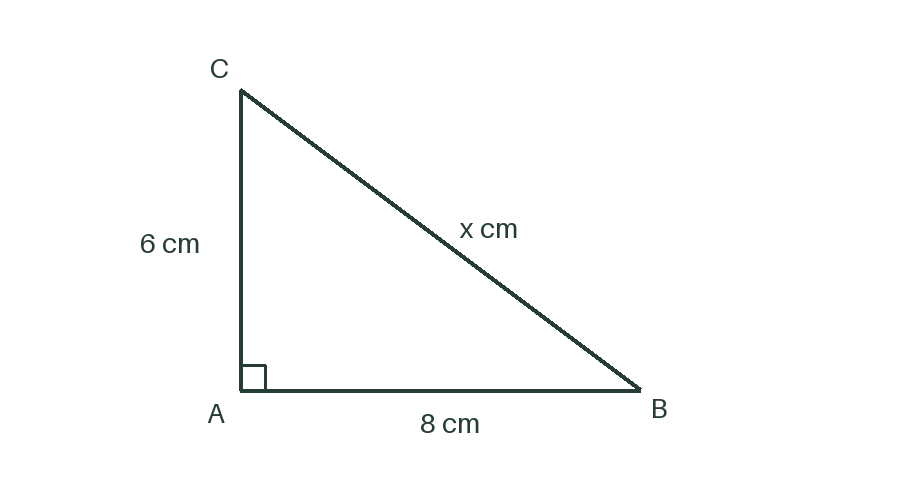
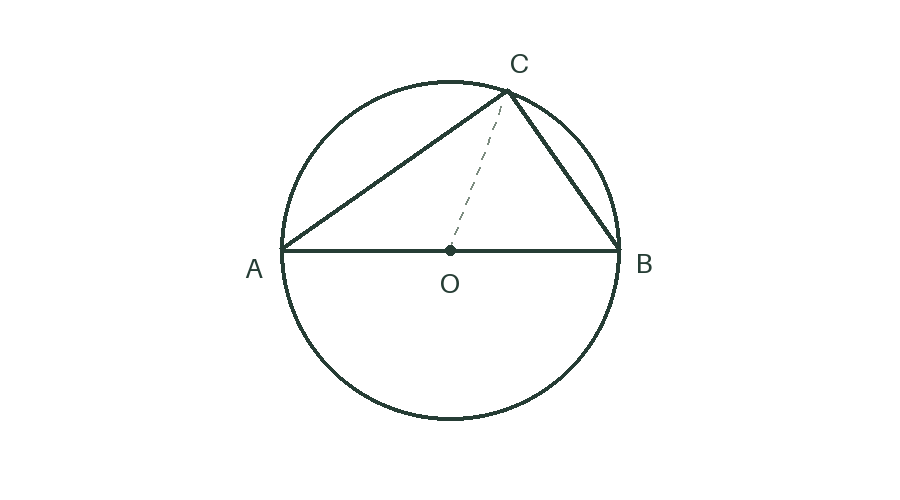
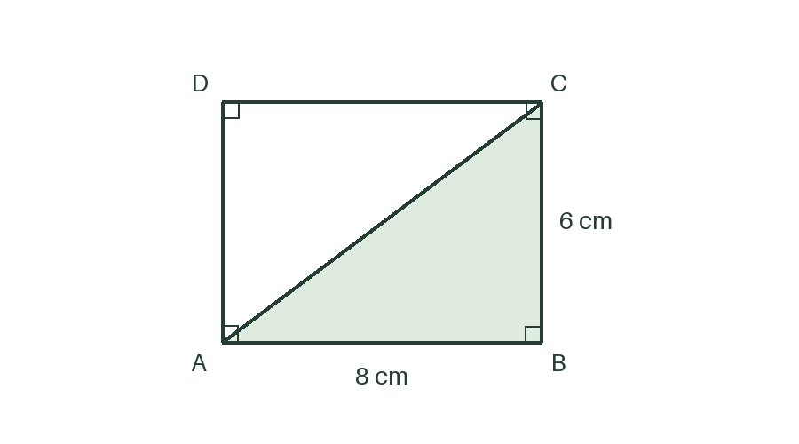

# 几何题显示示例

首页点击「体验几何三题示例」，即可离线加载下面三题。每题包含文字、行内公式、独立公式、SVG 图形和两个小问。通过「题1／题2／题3」切换，在编辑区域下方查看完整题面预览。修改文字后点击「更新题面预览」。几何图默认占题目区域宽度的 60%，可用滑块在 20%～100% 间调整，保存和组卷会保留比例。

示例不调用 Codex，不会自动入库。逐题确认并保存后，可以在「题库选题」选择三题，再到「排版组卷」设置留白、保存并打印。图形由几何 JSON 在浏览器中生成 SVG。编辑「几何 JSON」后点击「更新题面预览」，可以改变点位置和标注；修改坐标不会自动更新题目条件或边长标签。

## 直角三角形

在直角三角形 ABC 中，角 A 为直角，AB = 8 cm，AC = 6 cm，设 BC = x cm。



题面公式：

```latex
AB^2+AC^2=BC^2
```

1. 求斜边 BC 的长度，写出计算过程。
2. 求三角形 ABC 的面积。

展示重点：直角符号、边长标注、平方与角度公式、分步小问。

## 圆周角

AB 是圆 O 的直径，点 C 在圆上，角 CAB = 35°，连接 OC。



题面公式：

```latex
\angle BOC=2\angle BAC
```

1. 求角 ACB 与角 ABC 的度数。
2. 求劣弧 BC 所对圆心角 BOC 的度数。

展示重点：圆、圆心、直径、虚线辅助线、角符号及角度单位。

## 矩形阴影面积

矩形 ABCD 中，AB = 8 cm，BC = 6 cm。连接 AC，阴影部分为三角形 ABC。



题面公式：

```latex
S_{\triangle}=\frac{1}{2}bh
```

1. 求阴影面积，并说明它占矩形面积的几分之几。
2. 求对角线 AC 的长度。

展示重点：阴影填充、对角线、下标、分数及长度与面积单位。

## 核对答案

这些答案仅供核对示例，不写入题库或练习卷题面。当前数据模型没有答案解析字段。

| 题目 | 第一问 | 第二问 |
| --- | --- | --- |
| 直角三角形 | BC = √(8² + 6²) = 10 cm | 面积 = 8 × 6 ÷ 2 = 24 cm² |
| 圆周角 | 角 ACB = 90°，角 ABC = 55° | 角 BOC = 2 × 35° = 70° |
| 矩形阴影 | 面积为 24 cm²，占矩形面积的 1/2 | AC = √(8² + 6²) = 10 cm |

## 示例文件与再生成

- [生成脚本](scripts/generate_geometry_examples.py)：生成包含几何 JSON 的题目数据。
- [前端示例数据](static/demo.js)：包含三个题目的 JSON 对象与 geometry 块，点击时返回全新对象，避免上次编辑和已保存标记污染示例。
- `static/examples/`：文档使用的 SVG 图形。

在项目根目录执行以下命令可重建示例文件，不调用模型或访问网络：

```sh
.venv/bin/python scripts/generate_geometry_examples.py
```

几何块采用 `viewBox: [0, 0, 900, 500]` 和屏幕坐标。保存时 JSON 直接进入题目和练习卷快照，不创建 `bank_asset`。格式约束见 [geometry.schema.json](geometry.schema.json)，字段说明见 [几何格式说明](GEOMETRY.md)。
